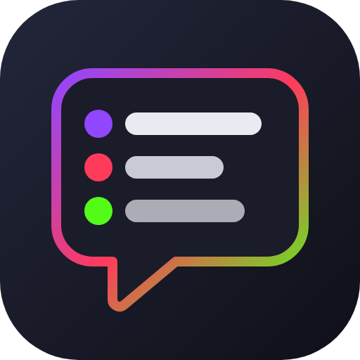
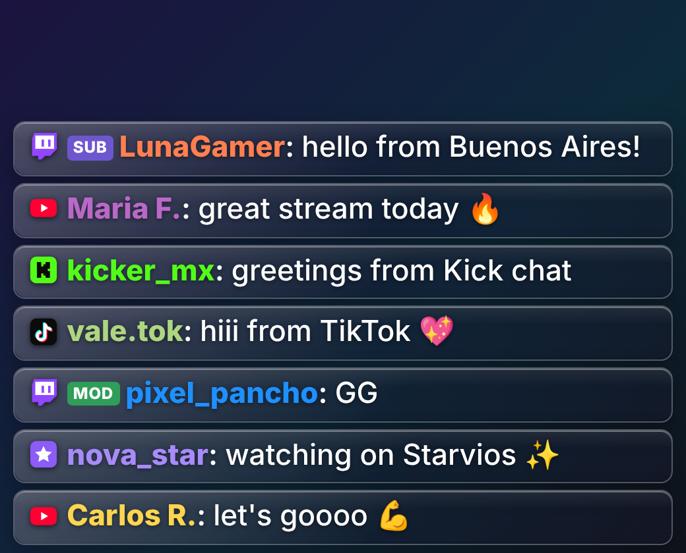
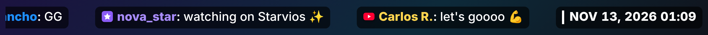

<div align="center">



# AC Multichat

**Los chats de Twitch, YouTube, Kick, TikTok y Starvios juntos en un dock de OBS y en tu escena. Detecta cuándo haces multistream y conecta solo los chats de las plataformas donde estás en directo.**

[](../../releases/latest)


[](LICENSE)
[](https://ko-fi.com/alejoxcode)

[English](README.md) · **Español**



[**⬇️ Descargar**](../../releases/latest) &nbsp;·&nbsp; [Instalar](#-instalar) &nbsp;·&nbsp; [Funciones](#-funciones) &nbsp;·&nbsp; [Preguntas frecuentes](#-preguntas-frecuentes)

</div>

---

Plugin nativo para OBS Studio 33 o superior: no necesita Python, cuentas, claves de API ni extensiones del navegador.

## ✨ Funciones

| | |
|---|---|
| 🧩 **Dock "Multichat"** | Todos los mensajes juntos con el logo de cada plataforma, insignias (MOD, VIP, SUB, HOST), emotes, Super Chats, bits, suscripciones y regalos de TikTok. |
| 👁 **Espectadores** | Cuántas personas te ven ahora en cada plataforma y el total, en el dock y en la ventana de chats. Se actualiza cada 30 s. |
| 📡 **Detección de multistream** | Al pulsar *Iniciar transmisión* comprueba en qué plataformas estás en directo y conecta esos chats. El dock avisa con **"Multistream detectado"**. |
| ➕ **Varios chats** | Añade todos los canales que quieras, también varios de la misma plataforma, desde **Herramientas → Multichat…** (o la rueda del dock → *Configurar…*). Al escribir o pegar el canal aparece su foto de perfil para confirmar que es el correcto; si no existe, avisa y pide **Añadir igualmente**. Si no se pudo comprobar (sin conexión o la plataforma no respondió), lo dice y deja añadirlo con **Añadir**. Cada chat se puede pausar sin quitarlo y reordenar arrastrando (el dock sigue ese orden). Para quitar uno, pulsa la ✕ a su derecha. |
| 🎬 **Fuente "Multichat"** | El chat en tu escena, con fondo transparente. En vertical (lista de mensajes) u horizontal (una cinta que pasa de derecha a izquierda). Sus Propiedades van en el orden de lo que más se cambia (Estilo, Texto, Diseño, Fecha y hora, Ventana flotante) y, con *Mostrar más opciones*, el resto. |
| ✨ **Preajustes y tipografía** | Un clic para cambiar el aspecto: Limpio, Neón, Burbujas, Minimal en una línea, Alto contraste y Vertical 1080×1920. Fuente, grosor, color del texto y del nombre, contorno, sombra e interlineado, y CSS propio para usuarios avanzados. Mira [Aspecto de las fuentes](#-aspecto-de-las-fuentes). |
| 🕒 **Fecha y hora en el chat** | La fuente "Multichat" puede mostrar la fecha y la hora (con o sin segundos, 24 h o 12 h, barra opcional): al final de la cinta en horizontal, o encima o debajo de los mensajes en vertical. Para ponerlas en cualquier otro lugar de la escena, separadas del chat, está la fuente **Multichat (fecha y hora)**. |
| 🎨 **Estilos de fondo** | Fondo por mensaje y fondo general (detrás de todo el chat), con color, opacidad, redondeo y borde. Estilos: Sólido, Cristal, Píldora, Ventana macOS, Minimal, Línea, Synthwave, GTA 6 (Vice City), Ciudad neón, Cyberpunk, Retro y Glitch. También en el recuadro de espectadores y en la fecha y hora. |
| 👁 **Fuente "Multichat (espectadores)"** | Un recuadro aparte con el logo y los espectadores de cada canal en directo, y el total. En fila o en columna, con o sin el nombre del canal. |
| 💰 **Super Chats de YouTube** | Los Super Chats y Super Stickers salen como en YouTube: una tarjeta con el color de su monto (de azul a rojo), el sticker incluido, y fijados arriba del chat un tiempo según lo pagado. En el dock, el monto lleva ese mismo color. Se puede desactivar en *Más opciones*. |
| ⭐ **Mensaje destacado** | Clic en un mensaje del dock y aparece en grande en pantalla con la fuente **"Multichat (destacado)"**: logo de la plataforma, nombre con su color, insignias, emotes y monto de las donaciones. Entra y sale con una animación y se oculta solo al rato. Clic otra vez o Esc para quitarlo, también con atajos de teclado. |
| 🔊 **Voz** | Lee el chat en voz alta en todas las escenas, con una casilla en la pestaña **Voz** de **Herramientas → Multichat…**. Aparece en el mezclador como «Multichat (voz)», llega a la emisión y tú también la oyes. También puede avisar con un sonido por mensaje (o sonido y lectura) para que te enteres sin mirar la pantalla. |
| 🌐 **Español e inglés** | Todo sigue el idioma de OBS: menús, errores de conexión, mensajes de ejemplo en pantalla y los avisos que arma Multichat (regalos de TikTok; raids, canjes, suscripciones y regalos de Starvios). Los avisos de Twitch y YouTube llegan ya escritos por la plataforma. |
| 🛡️ **Moderación** | Si un moderador borra un mensaje, o banea o expulsa temporalmente a alguien, sus mensajes desaparecen del dock, del chat en pantalla y del destacado. Mira [Moderación y filtros](#-moderación-y-filtros). |
| 🚫 **Filtros** | Oculta bots (Nightbot, StreamElements, Streamlabs… vienen de serie), comandos que empiezan por `!` y palabras bloqueadas, desde la pestaña **Filtros** de **Herramientas → Multichat…**. |
| 🪟 **Ventana flotante** | El chat (o cualquier fuente Multichat) en una ventana aparte, transparente y siempre encima, para verlo mientras juegas con un solo monitor. Mira [Ventana flotante](#-ventana-flotante-un-solo-monitor). |
| 🔇 **Silenciar canal** | Clic en un canal del dock para silenciar sus mensajes en Multichat o volver a mostrarlos. No toca la plataforma. |
| 🧪 **Mensajes de prueba** | Un solo interruptor (en la rueda del dock y en Configurar) que llena el dock con un chat de prueba y hace que las fuentes en pantalla muestren mensajes y números de ejemplo mientras no hay chat. Nunca salen mientras transmites. |
| 🔄 **Actualizaciones** | OBS avisa cuando hay una versión nueva y la instala si aceptas. |



## 📦 Instalar

Requiere **OBS Studio 33 o superior** (Windows 10/11, macOS 13+ o Linux x86_64). Con una versión anterior de OBS, el plugin no carga y OBS avisa de que «no se han podido cargar» los plugins: actualiza OBS primero.

Descarga el archivo de tu sistema desde **[Releases](../../releases/latest)** y **cierra OBS antes de instalar**.

### Windows

Desde OBS 33 los plugins se instalan en **`C:\ProgramData\obs-studio\plugins`**, una carpeta por plugin (ya no dentro de `C:\Program Files\obs-studio`).

1. Descarga `obs-multichat-<versión>-windows-x64.zip` y descomprímelo (clic derecho → **Extraer todo**). Queda la carpeta `obs-multichat`.
2. Abre `C:\ProgramData\obs-studio\plugins` (escríbelo en la barra del Explorador; `ProgramData` es una carpeta oculta). Si no existe la carpeta `plugins`, créala.
3. Copia ahí la carpeta `obs-multichat` (si ya estaba, reemplázala) y acepta el permiso de administrador. Debe quedar así:

   ```
   C:\ProgramData\obs-studio\plugins\obs-multichat\
   ├── obs-multichat.dll
   └── data\
       ├── manifest.json
       ├── locale\
       └── overlay\
   ```

4. Si instalaste una versión anterior en `C:\Program Files\obs-studio`, borra `obs-plugins\64bit\obs-multichat.dll` y la carpeta `data\obs-plugins\obs-multichat`: OBS 33 la marca como *Legacy* y OBS 34 ya no la carga.
5. Abre OBS.

### macOS

1. Descarga `obs-multichat-<versión>-macos.zip` y descomprímelo: queda `obs-multichat.plugin`.
2. Cópialo a `~/Library/Application Support/obs-studio/plugins/` (en el Finder: **Ir → Ir a la carpeta…**). Si ya había una versión, reemplázala.
3. En la Terminal, una vez: `xattr -cr ~/Library/Application\ Support/obs-studio/plugins/obs-multichat.plugin`
4. Abre OBS.

### Linux

Compilado en Ubuntu 24.04 para el OBS del [PPA oficial](https://launchpad.net/~obsproject/+archive/ubuntu/obs-studio) (`sudo add-apt-repository ppa:obsproject/obs-studio`); sirve en Ubuntu 24.04 o más nuevo y distribuciones derivadas (Linux Mint 22, Pop!_OS 24.04…). Las fuentes en pantalla usan la fuente de navegador de OBS: el OBS del PPA la trae, el paquete `obs-studio` de los repositorios de Ubuntu no.

1. Descarga `obs-multichat-<versión>-linux-x86_64.tar.gz`.
2. Descomprímelo en la carpeta de plugins de tu usuario:

   ```bash
   mkdir -p ~/.config/obs-studio/plugins
   tar -xzf obs-multichat-*-linux-x86_64.tar.gz -C ~/.config/obs-studio/plugins
   ```

   Debe quedar así:

   ```
   ~/.config/obs-studio/plugins/obs-multichat/
   ├── bin/64bit/obs-multichat.so
   └── data/
       ├── manifest.json
       ├── locale/
       └── overlay/
   ```

3. Abre OBS.

**OBS de Flathub (Flatpak):** la carpeta de plugins es otra. Descomprímelo así:

```bash
mkdir -p ~/.var/app/com.obsproject.Studio/config/obs-studio/plugins
tar -xzf obs-multichat-*-linux-x86_64.tar.gz -C ~/.var/app/com.obsproject.Studio/config/obs-studio/plugins
```

El Flatpak de OBS no trae espeak-ng: ahí funciona todo menos leer el chat en voz alta.

La voz usa **espeak-ng**, que Ubuntu de escritorio suele traer; si falta: `sudo apt install espeak-ng`.

### Actualizaciones automáticas

Al abrir OBS, el plugin revisa si hay una versión nueva en las Releases de GitHub. Si la hay, muestra un aviso con **Actualizar ahora**, **Más tarde** u **Omitir esta versión** (y el dock **Multichat** lo recuerda con su botón). **Actualizar ahora** la descarga, comprueba su suma SHA-256, la instala y pide reiniciar OBS. También se puede revisar a mano con **Buscar actualizaciones**, en **Herramientas → Multichat…** o en la rueda del dock.

Antes de instalar, el plugin compara el archivo descargado con la suma SHA-256 publicada en la Release: la que da GitHub para cada archivo y, si falta, el `SHA256SUMS` que se publica junto a los zips. Si no coincide o no se puede obtener, no instala nada y lo dice; la versión se puede descargar a mano desde la página.

- **Windows:** se instala en `C:\ProgramData\obs-studio\plugins\obs-multichat`, que es de administrador: Windows pide permiso una vez para copiar el plugin. Si estaba en la carpeta de antes (`C:\Program Files\obs-studio`), queda en la nueva y se quita la copia de antes. Si la copia tarda más de 3 minutos (un antivirus lento, por ejemplo), el plugin avisa de que sigue en marcha en vez de darla por fallida. Pendiente antes de la próxima versión: el script elevado y los archivos extraídos quedan en la carpeta temporal del usuario entre la comprobación y el permiso de administrador.
- **macOS:** se reemplaza `obs-multichat.plugin` en su carpeta y se le quita la marca de "descargado de internet", así que macOS no vuelve a pedir permiso.
- **Linux:** se reemplaza en `~/.config/obs-studio/plugins/obs-multichat`, sin pedir permisos (descarga con `curl` o, si no está, con `wget`).

Para ver la versión instalada: **Herramientas → Gestor de plugins** (OBS 33).

## 🎛️ Usarlo

La primera vez que abres OBS con el plugin, sin chats configurados, aparece el **asistente de inicio**: la plataforma viene elegida según tu servicio de emisión, añades tu canal, un botón pone el chat y el destacado en la escena que estás editando (sin duplicarlos si ya están), una casilla activa *Leer el chat en voz alta* y al terminar se abre el dock. Se puede saltar y volver a abrir con **Asistente de inicio**, en **Herramientas → Multichat…** o en la rueda del dock.

1. **Herramientas → Multichat…**. Elige la plataforma, escribe el canal y pulsa **Añadir**. También puedes pegar la URL del canal o de un directo de YouTube. Mientras busca el canal se ve una barra de carga; si el nombre tiene un formato que la plataforma no admite, lo dice debajo, y si el canal no existe, el botón pasa a **Añadir igualmente** (Intro nunca añade un canal no encontrado).
   - **Pausar**: desmarca la casilla de un chat para desconectarlo sin perderlo; vuelve a marcarla para reconectarlo.
   - **Ordenar**: arrastra los chats (o selecciona uno y pulsa **Alt+↑ / Alt+↓**). Los chips del dock siguen el mismo orden.
   - **Quitar**: la ✕ de la fila o la tecla **Supr** con el chat seleccionado.
2. **Docks → Multichat** para ver el chat dentro de OBS (el asistente lo abre al terminar).
3. **Añadir fuentes a la escena** (en Configurar) pone de una vez el chat y el destacado en la escena que editas, solo los que falten. Para hacerlo a mano o para las demás fuentes: **Fuentes → + → Multichat (chat en pantalla)**. Para la cinta horizontal elige *Disposición → Horizontal*. Con *Ajustar al lienzo automáticamente* (activado por defecto) ocupa todo el ancho del lienzo con el alto justo de una línea; desactívalo para poner el tamaño a mano. El *Movimiento* puede ser continuo o por comentario (avanza con cada mensaje y se detiene). Con *Fecha y hora → Mostrar fecha y hora* la cinta termina con la fecha y la hora a la derecha; en vertical van encima o debajo de los mensajes (*Posición en vertical*).
4. Para los espectadores en pantalla: **Fuentes → + → Multichat (espectadores)**.
5. La fecha y la hora son una opción del chat (grupo **Fecha y hora** en sus Propiedades). Si las quieres en otro lugar, separadas del chat, usa **Fuentes → + → Multichat (fecha y hora)**.
6. Para que lea el chat en voz alta: **Herramientas → Multichat… → Voz → Leer el chat en voz alta**. Mira [Leer el chat en voz alta](#-leer-el-chat-en-voz-alta).
7. Para mostrar en grande un mensaje concreto: **Fuentes → + → Multichat (destacado)**. Mira [Destacar un mensaje](#-destacar-un-mensaje).

### 🧩 El dock

- **Leer con calma**: si subes para leer, la lista no se mueve aunque lleguen mensajes. Aparece la píldora **↓ N nuevos**; clic en ella o **Fin** para volver al final.
- **Clic derecho en un mensaje**: *Destacar en pantalla* / *Quitar destacado*, *Ocultar mensaje*, *Ocultar usuario*, *Copiar mensaje* y *Copiar nombre* (texto plano).
  - *Ocultar mensaje* lo quita del dock, del chat en pantalla y del destacado, igual que un borrado de moderación, pero solo en Multichat: no toca la plataforma. Funciona también con los mensajes de prueba.
  - *Ocultar usuario* lo añade a **Filtros → Ocultar usuarios** y quita sus mensajes de ese chat.
- **Buscar**: **Ctrl+F** (⌘F en macOS) o el botón de la lupa. Filtra por texto, emote o nombre, sin distinguir mayúsculas ni tildes, y dice cuántos coinciden. **Esc** cierra la búsqueda.
- **Hora**: clic derecho → *Mostrar hora* añade la hora a cada mensaje (apagado por defecto; se recuerda).
- **La rueda** (arriba a la derecha): *Configurar…*, *Mensajes de prueba*, *Mostrar hora*, *Tamaño del texto*, *Volver a detectar en qué plataformas estás en directo*, *Asistente de inicio* y *Buscar actualizaciones*.
- **Vaciar el chat**: el botón de la papelera vacía el dock, el chat en pantalla y el destacado. Durante unos segundos aparece **Chat vaciado · Deshacer**; *Deshacer* devuelve los mensajes al dock y al chat en pantalla (en la cinta horizontal, solo los 3 últimos). Si vacías dos veces seguidas, *Deshacer* devuelve todo. La voz no los vuelve a leer.
- **Tema**: los íconos y los colores se adaptan al tema de OBS, claro u oscuro.

### ⭐ Destacar un mensaje

1. Añade **Fuentes → + → Multichat (destacado)** a tu escena. Con *Mensajes de prueba* activado muestra un mensaje de ejemplo mientras no hay ninguno destacado, para colocarla (nunca al transmitir).
2. En el dock **Multichat**, haz clic en un mensaje: aparece en la fuente y se resalta en el dock. Otro clic en otro mensaje lo reemplaza.
3. Mientras está en pantalla, una barra arriba de la lista del dock lo muestra con dos botones: **⏸ Pausar** lo deja en pantalla sin tiempo, hasta que lo quites (**▶ Reanudar** vuelve a contar desde donde se pausó), y **✕ Quitar** lo saca.
4. Para quitarlo: **✕ Quitar**, clic otra vez en el mensaje resaltado o **Esc** con el dock seleccionado.

En sus **Propiedades** eliges la animación (deslizar, fundido, zoom o ninguna), la posición dentro de la fuente, el tamaño de letra, el ancho y el alto, el fondo con los mismos estilos que el chat y si se ven el logo y las insignias. Con *Se quita solo* (activado por defecto) se queda en pantalla 8 s más 60 ms por carácter, como mucho 30 s; desactívalo para dejarlo hasta que lo quites. El tiempo lo lleva el plugin, no la página: al vencer, el dock deja de resaltar el mensaje a la vez que desaparece de pantalla, y *volver a mostrar el último* sigue funcionando. Si tienes varias fuentes de destacado con tiempos distintos, manda la más corta de las que tengan *Se quita solo* activado; si ninguna lo tiene, el mensaje se queda hasta que lo quites.

En **Ajustes → Atajos** hay tres atajos sin tecla asignada: *Multichat: quitar mensaje destacado*, *Multichat: volver a mostrar el último destacado* y *Multichat: pausar o reanudar el tiempo del destacado*. Asígnales la tecla que quieras.

Si la página de la fuente se recarga, el destacado vuelve a aparecer solo si aún no venció su tiempo. Limpiar el chat desde el dock también quita el destacado.

### 🎨 Aspecto de las fuentes

Las Propiedades de las fuentes (chat, destacado, espectadores y fecha y hora) siguen el orden de lo que más se cambia:

1. **Estilo**: el preajuste y todo lo del fondo. En el chat, el *Estilo del fondo* (común a los dos), *Detrás de cada mensaje* (color, opacidad, redondeo y borde según el estilo, y relleno de cada mensaje) y *Detrás de todo el chat* (el fondo general). En las demás, el fondo del recuadro con su estilo. Cada parte solo muestra sus controles con su casilla activada.
2. **Texto**: tamaño de letra, fuente, grosor y colores del texto y del nombre. El color del contorno y el color y desenfoque de la sombra solo aparecen si los usas.
3. **Diseño**: vertical u horizontal, tamaño o ajustar al lienzo, apilado y velocidad (chat); posición y tamaño (destacado); fila o columna, total y nombres (espectadores).
4. **Fecha y hora** (chat): la casilla y, al activarla, sus opciones.
5. **Ventana flotante (un solo monitor)**: la casilla y, al activarla, sus opciones. Mira [Ventana flotante](#-ventana-flotante-un-solo-monitor).
6. **Más opciones**, plegadas de serie con la casilla **Mostrar más opciones** justo encima: plataformas, iconos e insignias, animación y *Se quita solo* (destacado), desaparecer después de, máximo de mensajes, espacios, márgenes, interlineado y CSS personalizado.

Las escenas guardadas siguen igual: no cambió ninguna opción existente, solo dónde se ve.

- **Preajuste** (arriba, en *Estilo*): elige uno y se ajustan varias opciones a la vez; puedes seguir tocando todo. Si cambias algo de lo que puso el preajuste, la lista vuelve a *Personalizado*.

  | Preajuste | Cómo se ve |
  |---|---|
  | Limpio | Texto blanco con sombra suave, sin recuadros. |
  | Neón | Recuadros synthwave, nombres del color de la plataforma y brillo magenta. |
  | Burbujas | Burbujas oscuras muy redondeadas, sin sombra y con más aire. |
  | Minimal en una línea | En el chat, la cinta horizontal ajustada al lienzo sobre una franja oscura con la fecha y la hora. En las demás, recuadro negro mate. |
  | Alto contraste | Recuadros negros opacos con borde blanco, texto en negrita y nombres amarillos. |
  | Vertical 1080×1920 | Burbujas de cristal grandes para un lienzo vertical (chat de 1000×1400). |

- **Estilo**: fuente (las instaladas en el equipo; si falta, se usa la del sistema), grosor, color del texto, color del nombre (el del usuario, el de la plataforma o uno fijo; chat y destacado), contorno y sombra (*Automática*, como antes: solo sin fondo; *Siempre*; *Nunca*) con su color y desenfoque. El interlineado (chat y destacado) está en *Más opciones*.
- **Más opciones → CSS personalizado**: CSS que se añade a la página después de los estilos del plugin (hasta 20 KB). Solo CSS: nunca se ejecuta código. Por ejemplo `.author { text-transform: uppercase; }`.

### 🛡 Moderación y filtros

Cuando los moderadores de una plataforma borran un mensaje o banean a alguien, Multichat lo quita del dock (sin mover la lista si estás leyendo más arriba), del chat en pantalla (con su animación de salida) y del mensaje destacado. El borrado solo afecta al canal donde ocurrió: nunca a los mensajes de otro chat.

| Plataforma | Mensaje borrado | Ban o expulsión temporal | Vaciar el chat |
|---|---|---|---|
| Twitch | ✅ | ✅ | ✅ |
| YouTube | ✅ | ✅ (mensajes ocultados del autor) | — |
| Kick | ✅ | ✅ | ✅ |
| Starvios | ✅ | — | — |
| TikTok | — | — | — |

TikTok no envía, en lo que lee Multichat, ningún aviso de borrado que se pueda relacionar con los mensajes ya mostrados. Starvios solo avisa de mensajes borrados.

En **Herramientas → Multichat… → Filtros** puedes:

- **Ocultar usuarios**: uno por línea. Vienen los bots más comunes (Nightbot, StreamElements, Streamlabs, Moobot, Fossabot, Wizebot, Botrix); el botón *Añadir bots conocidos* los recupera si los borraste.
- **Ocultar comandos**: los mensajes que empiezan por `!` (activado de serie). Las suscripciones, Super Chats, bits y regalos se muestran siempre.
- **Palabras bloqueadas**: una palabra o frase por línea. Se compara la palabra entera, sin distinguir mayúsculas ni tildes: *tonto* oculta «TÓNTO» pero no «tontería».

Los filtros se guardan al momento y se aplican a los mensajes que llegan a partir de ahí; los mensajes ocultos tampoco se leen en voz alta.

### 🪟 Ventana flotante (un solo monitor)

Para ver el chat mientras juegas con un solo monitor, abre las Propiedades de cualquier fuente Multichat (chat, espectadores, fecha y hora o destacado) y, en **Ventana flotante (un solo monitor)**, marca **Mostrar también en una ventana flotante**. Se abre una ventana aparte, fuera de OBS, transparente y siempre encima, con lo mismo que muestra esa fuente: los mismos estilos, disposición y opciones.

- **Disposición en la ventana** (fuente de chat): *La misma de la fuente*, *Vertical* u *Horizontal*. Así la ventana puede ir en vertical aunque en la escena uses la cinta, o al revés; con disposición propia, el chat se adapta al tamaño de la ventana.
- **Fecha y hora en la ventana** (fuente de chat): *Igual que en la fuente*, *Mostrar* u *Ocultar*, sin cambiar la fuente.
- **Estilo en la ventana** (fuente de chat): *El mismo de la fuente* o *Chat limpio (sin fondos)*, que muestra solo el texto de los mensajes aunque la fuente use un estilo como GTA 6.
- **Muévela** arrastrándola y **cambia su tamaño** desde los bordes. Se vuelve a abrir donde la dejaste.
- **Clic derecho** en ella: *Los clics atraviesan la ventana*, la opacidad y *Cerrar la ventana flotante*.
- Con **Los clics atraviesan la ventana**, el ratón va al juego. Para volver a moverla, desmárcala en las Propiedades o usa el atajo *Multichat: ventana flotante, los clics la atraviesan o no* (**Ajustes → Atajos**).
- **No sale en las capturas de pantalla:** en Windows (10 versión 2004 o superior) y macOS, una fuente de captura de pantalla de OBS no muestra la ventana flotante. En macOS 15 o superior, si aun así sale, marca *Ocultar OBS de la captura* en la fuente de captura de pantalla. En Linux el sistema no permite excluir una ventana: captura la ventana del juego en lugar de la pantalla completa.
- Se ve sobre juegos **en ventana** o en **pantalla completa sin bordes**. En pantalla completa exclusiva ninguna ventana puede verse encima: así funciona el sistema.
- No hace falta que la fuente se vea en la escena que transmites. Con **Solo en la ventana flotante (no se ve en OBS ni en la emisión)** no se dibuja en la escena: no sale en la vista previa, la emisión ni la grabación. Solo la ves tú, en la ventana.

### 🔊 Leer el chat en voz alta

Funciona en Windows, macOS y Linux con las voces del sistema, sin servicios externos. En Linux usa **espeak-ng**: la voz es más robótica que las de Windows y macOS.

1. Abre **Herramientas → Multichat…**, pestaña **Voz**, y marca **Leer el chat en voz alta** (también está en el asistente de inicio). Ahí eliges la voz, la velocidad, si se lee el nombre de quien escribe, qué plataformas se leen y el máximo de caracteres por mensaje. No hay que añadir ninguna fuente: suena en todas las escenas.
2. Al activarla aparece **Multichat (voz)** en el **mezclador de audio**. Ahí se ajustan el volumen, el silencio, la monitorización y los filtros de audio, como en cualquier otro audio, y se guardan entre sesiones. La primera vez viene en *Monitorizar y emitir*: llega a la emisión y a la grabación y tú también la oyes. Al desmarcar la casilla desaparece del mezclador.
3. Las palabras bloqueadas, los usuarios ocultos y los comandos son los de la pestaña **Filtros**: lo que ocultan no se muestra ni se lee.

Si vienes de una versión anterior: la primera vez se toman los ajustes de la primera fuente de voz de tus escenas que hubieras cambiado (activada o no, como estuviera) y las palabras bloqueadas de todas ellas pasan, sin repetir, a la pestaña **Filtros**. Esas fuentes antiguas siguen cargando pero ya no leen nada; puedes eliminarlas.

Qué se lee y qué no:

- Solo mensajes nuevos, nunca el historial.
- No se leen los emotes, los enlaces ni los emojis. Un mensaje que se queda sin letras ni números se omite.
- Sí se leen los avisos del chat (suscripciones, regalos…). Un `/me` de Twitch se lee como «Ana saluda».
- Un mensaje oculto por los filtros (por ejemplo, con una palabra bloqueada) no se lee.
- Si un mensaje se borra (moderación de la plataforma u *Ocultar mensaje* en el dock) antes de leerse, sale de la cola; si se estaba leyendo, se corta.
- Se leen de uno en uno. Si la cola llega a 20 mensajes, se descarta el más antiguo para no acumular retraso.
- **Al llegar un mensaje** elige qué hace la voz: *Leerlo en voz alta* (lo de siempre), *Avisar con un sonido* (un aviso corto por mensaje, sin leer, para enterarte sin mirar la pantalla) o *Sonido y luego leerlo*. El aviso viene integrado; puedes poner un WAV propio (PCM de 16 bits, hasta 10 s) y limitar cuántos suenan con *Mínimo entre dos avisos* (por defecto 1,5 s; en el modo mixto solo limita el sonido). Las plataformas elegidas y los filtros valen para los tres modos, y un mensaje borrado antes de sonar no suena (tampoco los que quedaban en cola de alguien expulsado o silenciado en ese chat).
- El botón *Saltar el mensaje actual* corta el que se está leyendo. Al desmarcar *Leer el chat en voz alta* se vacía la cola y se detiene la voz.
- Los *Mensajes de prueba* también se leen, para escuchar la voz sin estar en directo, pero nunca mientras transmites.

Límites: el primer mensaje puede tardar unos segundos en sonar mientras el sistema carga la voz, y solo se quitan los enlaces que empiezan por `http://`, `https://` o `www.`, así que `ejemplo.com` se leería.

### Cuándo se conecta cada chat

| Modo | Comportamiento |
|---|---|
| **Automático** (por defecto) | Comprueba cada minuto qué canales están en directo y conecta solo esos chats. Al empezar a transmitir lo comprueba cada 15 s durante 3 minutos. Si no se puede saber el estado de un canal, lo conecta mientras OBS esté transmitiendo. |
| **Siempre conectado** | Conecta todos los chats aunque no estés en directo. En YouTube, TikTok y Starvios espera a que empiece el directo. |

Los chats pausados no se conectan en ningún modo.

Funciona con cualquier forma de hacer multistream (Restream, *Multiple RTMP outputs*, Aitum Multistream…), porque consulta a cada plataforma directamente. Si el servicio de emisión de OBS es Restream, Castr o StreamYard, también se marca como multistream.

### ⚡ Chat de YouTube al instante (opcional)

Sin configurar nada, el plugin le pregunta a YouTube por mensajes nuevos cada 2 segundos. Si conectas tu cuenta de Google, usa la API oficial de YouTube y los mensajes llegan apenas se escriben, como en Twitch y Kick. El permiso es de **solo lectura**: el plugin no puede publicar ni cambiar nada en tu canal.

**Conéctalo en OBS:** en el dock, ⚙ → *Ajustes* → pestaña **YouTube** → **Iniciar sesión con Google**. Se abre el navegador: elige tu cuenta y acepta el permiso. Listo, no hay que configurar nada más.

> **Mientras Google verifica la app:** por ahora solo pueden iniciar sesión las cuentas de prueba que se hayan añadido. Si Google muestra «Acceso bloqueado», tu cuenta todavía no está habilitada; el chat de YouTube sigue funcionando igual, con el método normal.

<details>
<summary><b>Avanzado: usar tu propia aplicación de Google Cloud</b></summary>

Si prefieres no usar la aplicación de AC Multichat (o compilas el plugin tú mismo), puedes crear una propia una sola vez (es gratis y no pide tarjeta):

1. **Crea el proyecto:** entra a [console.cloud.google.com/projectcreate](https://console.cloud.google.com/projectcreate), ponle un nombre (por ejemplo `AC Multichat`) y pulsa **Crear**.
2. **Activa la API:** abre [YouTube Data API v3](https://console.cloud.google.com/apis/library/youtube.googleapis.com) con ese proyecto elegido y pulsa **Habilitar**.
3. **Configura la pantalla de permiso:** en [Google Auth Platform](https://console.cloud.google.com/auth/overview) pulsa **Comenzar**; escribe un nombre de app y tu correo, elige público **Externo**, vuelve a poner tu correo como contacto y acepta.
4. **Añádete como usuario de prueba:** en **Público** → **Usuarios de prueba** → **Agregar usuarios**, escribe la cuenta de Google con la que vas a iniciar sesión.
5. **Crea el cliente:** en **Clientes** → **Crear cliente**, elige el tipo **App de escritorio**, ponle un nombre y pulsa **Crear**. Copia el **ID de cliente** y el **secreto de cliente** (el secreto solo se muestra en ese momento).
6. **Conéctalo en OBS:** en la pestaña **YouTube**, marca **Usar mi propia aplicación de Google Cloud (avanzado)**, pega los dos valores y pulsa **Iniciar sesión con Google**. En el aviso de «Google no verificó esta app» pulsa *Continuar* (es tu propia app).

</details>

Cuando haya un directo de YouTube conectado, la pestaña dirá *chat instantáneo activo*. Si la API no se puede usar (se agotó la cuota diaria, falló el permiso…), el plugin sigue con el método normal y ahí mismo te dice el motivo.

- Mientras la app de Google esté en modo *Prueba*, Google caduca la sesión a los 7 días: basta con volver a pulsar **Iniciar sesión**.
- Por este camino no llegan las imágenes de los emojis personalizados del canal ni de los Super Stickers (se ve su texto), y las insignias de miembro no muestran su dibujo.
- La sesión se guarda en el archivo de configuración del plugin en tu equipo; no se envía a ningún otro sitio que no sea Google.

### Notas por plataforma

- **Twitch:** conexión IRC anónima, de solo lectura.
- **YouTube:** lee el chat público del directo, sin clave de API. Con `@canal` busca solo el directo activo.
- **Kick:** a veces Kick bloquea la consulta que da el ID del chat. Si el canal queda en error, añádelo con el ID: `micanal#123456`. Para verlo, abre `https://kick.com/api/v2/channels/micanal` en el navegador y busca `"chatroom":{"id":…}`.
- **TikTok:** escribe tu usuario (`@micanal`) o pega la URL. TikTok exige firmar la conexión al chat, así que el plugin usa [Euler Stream](https://www.eulerstream.com), un servicio externo gratuito y sin cuenta que limita las conexiones por día. Si se pasa del límite, el chat queda en error y se reintenta a los 10 minutos. Muestra los comentarios y los regalos.
- **Starvios:** escribe tu usuario (`micanal`) o pega la URL (`https://starvios.com/live/micanal`). No pide cuenta ni clave: el chat se lee de forma anónima y solo de lectura, como lo hace su web, y el plugin no cuenta como espectador. Los mensajes perdidos durante una reconexión se muestran, pero no se leen en voz alta. **Este conector no es oficial** y puede dejar de funcionar si Starvios cambia.

YouTube, Kick, TikTok y Starvios no tienen una API pública oficial para leer el chat sin cuenta: si cambian su web, puede que haya que actualizar el plugin.

## ❓ Preguntas frecuentes

<details>
<summary><b>OBS dice que el plugin «no se ha podido cargar»</b></summary>

Tienes OBS 32 o anterior: actualiza OBS a la 33 o superior. En Windows, revisa también que el plugin esté en `C:\ProgramData\obs-studio\plugins\obs-multichat\` y no en las carpetas de antes en `C:\Program Files\obs-studio`.
</details>

<details>
<summary><b>Un chat se queda en error</b></summary>

**Herramientas → Multichat…** muestra el motivo debajo del canal. En Kick, añádelo con el ID del chat (mira [Notas por plataforma](#notas-por-plataforma)). En TikTok, puede que el servicio gratuito de firma haya llegado a su límite diario: se reintenta solo a los 10 minutos. El registro de OBS (**Ayuda → Archivos de registro**) tiene las líneas `[obs-multichat]`.
</details>

<details>
<summary><b>El chat no se conecta si no estoy en directo</b></summary>

Es el modo **Automático**: solo conecta los canales que están en directo. Cambia a **Siempre conectado** en **Herramientas → Multichat…**, o usa *Mensajes de prueba* para colocar el overlay.
</details>

<details>
<summary><b>macOS dice que el plugin está dañado o lo bloquea</b></summary>

Ejecuta el comando `xattr -cr …` de los pasos de instalación. El plugin no está firmado con una cuenta de desarrollador de Apple de pago.
</details>

## 🔒 Privacidad

- Sin cuentas propias y sin telemetría. Todo corre dentro de OBS en tu computador; no hay ningún servidor nuestro.
- **Inicio de sesión con Google (opcional):** solo si lo activas para el chat de YouTube al instante. Se pide permiso de solo lectura (`youtube.readonly`) y la sesión se guarda en tu equipo; solo se usa para hablar con Google y YouTube. Detalles en la [política de privacidad](https://www.alejoxcode.com/privacidad).
- Para leer los chats y los espectadores, el plugin habla directamente y de forma anónima con cada plataforma que añades: Twitch (IRC y su GraphQL público), YouTube, Kick, TikTok y Starvios (su punto de acceso público de Supabase). Los emotes y las fotos de perfil se cargan de los servidores de imágenes de cada plataforma.
- **Solo TikTok:** el ID de la sala del canal de TikTok que añades se envía a [Euler Stream](https://www.eulerstream.com) para firmar la conexión.
- **Actualizaciones:** al abrir OBS, el plugin pregunta a la API de GitHub por la última Release de este repositorio y, solo si aceptas, la descarga de GitHub.
- Los canales que añades y tus ajustes se guardan en la carpeta de configuración de OBS de tu computador.

## 🛠️ Compilar

El plugin usa la [plantilla oficial de plugins de OBS](https://github.com/obsproject/obs-plugintemplate) actualizada a **OBS 33.0.0**: obs-deps y Qt 6.11 del `2026-10-23`, macOS 13+ universal, Windows x64. La configuración descarga las dependencias sola. En Linux usa el OBS, Qt 6, libcurl y espeak-ng del sistema.

```bash
# macOS (Xcode 26.5+: OBS 33 exige el SDK de macOS 26.5)
cmake --preset macos && cmake --build --preset macos

# Windows (Visual Studio 2022, SDK 10.0.26100)
cmake --preset windows-x64
cmake --build --preset windows-x64

# Ubuntu 24.04 (con el OBS del PPA oficial)
sudo apt install obs-studio qt6-base-dev qt6-base-private-dev libcurl4-openssl-dev libespeak-ng-dev libsimde-dev ninja-build
cmake --preset ubuntu-x86_64 && cmake --build --preset ubuntu-x86_64
```

Pruebas de los parsers (sin OBS ni red, solo Qt 6 Core):

```bash
cmake -S tests -B build_tests && cmake --build build_tests && ctest --test-dir build_tests
```

Cada push compila en GitHub Actions para Windows, macOS y Linux (`.github/workflows/build.yml`). Para publicar una versión, sube `version` en `buildspec.json` y en `data/manifest.json` (CI comprueba que coincidan) y súbelo a `main`: el flujo *Publicar versión* crea el tag `v<versión>` y la Release con los paquetes de los tres sistemas. También se puede empujar el tag a mano o lanzar el flujo desde Actions.

### Estructura

```
src/plugin-main.cpp        carga del plugin, dock, menú y eventos de emisión; conecta el manager con OBS
src/chat-manager.*         detección en vivo / multistream y ciclo de vida de los chats (sin OBS: recibe config, traductor y log)
src/chat-history.*         historial reciente, borrados y "deshacer limpiar"
src/featured-state.*       mensaje destacado: actual, último, copia para deshacer y tiempo en pantalla
src/config-store.*         config.json (con "version") y guardado atómico de los JSON del plugin
src/i18n.*                 textos traducidos (i18n::tr) de data/locale
src/platforms-registry.hpp plataformas: id, nombre, color y orden (data/overlay/icons.js lleva una copia comprobada por las pruebas)
src/overlay/               fuentes "Multichat", "Multichat (espectadores)", "Multichat (destacado)" y "Multichat (fecha y hora)" (fuentes de navegador privadas)
  source.cpp               callbacks de OBS y registro de las fuentes
  properties.cpp           ventana de propiedades
  config.cpp               ajustes → configuración que recibe cada página
  viewers-layout.cpp       tamaño de los recuadros (medido siempre en el hilo de la interfaz) y ajuste de la cinta al lienzo
  box-measure.*            medida pura de los recuadros de espectadores y reloj con QFont (sin OBS, con pruebas en tests/test-box-measure.cpp)
  wiring.cpp               estado compartido y reparto de los eventos del manager a las páginas
src/overlay-presets.*      valores por defecto, preajustes y saneado de CSS/colores/fuentes (sin OBS, con pruebas en tests/test-overlay.cpp)
src/tts/                   voz: ajustes globales y migración (voice-settings), salida propia "Multichat (voz)" en un canal de salida libre (voice-source; las fuentes v0 y v2 guardadas en escenas cargan en silencio), filtro de texto, cola, envío a ritmo real y voz (AVSpeechSynthesizer en macOS, SAPI en Windows, espeak-ng en Linux)
src/chat/                  conectores y parsers: twitch, youtube, kick, tiktok, starvios, demo
src/net/                   red del sistema: WinHTTP (Windows), NSURLSession (macOS) y libcurl (Linux)
src/ui/                    dock (chat-dock, chat-view, dock-prefs), ventana de configuración (settings-dialog, channel-input, chat-list), asistente de inicio, cachés de emotes y de perfiles
data/icons/                íconos SVG monocromos del dock (se tiñen con el color del tema)
src/updater.*              actualizaciones automáticas desde las Releases de GitHub: consulta, descarga y comprobación SHA-256
src/updater/               instaladores por sistema (install-win/-mac/-linux.cpp, solo se compila el del sistema), copy-tree.cpp y el script de PowerShell (install-script-win.hpp)
data/overlay/              páginas del chat (index.html), el destacado (featured.html), los espectadores (viewers.html) y la fecha y hora (clock.html); icons.js y overlay.js son el código compartido
data/locale/               textos en español e inglés (también los avisos del chat y los errores de conexión, según el idioma de OBS)
tests/                     pruebas sin OBS: parsers (test-chat), voz (test-tts), overlay (test-overlay), medida de recuadros (test-box-measure, QtGui sin pantalla), manager (test-manager) y JS de las páginas (overlay-js.test.js, con node si está instalado)
```

¿Por qué red nativa y no QtNetwork? OBS 33 no instala los plugins TLS de Qt, así que HTTPS con QtNetwork no funciona dentro de OBS. WinHTTP y NSURLSession soportan HTTPS y WebSocket sin dependencias extra. En Linux, libcurl (que OBS ya usa) hace HTTPS y la conexión TLS del WebSocket; el protocolo WebSocket va en `src/net/net-linux.cpp`.

## ☕ Apoyar

AC Multichat es gratis y lo va a seguir siendo. Si te ahorra tiempo en tus directos, puedes [invitarme un café en Ko-fi](https://ko-fi.com/alejoxcode): paga horas de desarrollo y las próximas funciones. El plugin nunca lo pide solo; el enlace está al final de las Propiedades de cada fuente y en el menú de la rueda del dock.

## 🤖 Cómo está hecho este plugin

AC Multichat se desarrolla con la ayuda de un asistente de programación con IA (Claude): gran parte del código se escribió con él. Alejandro (Alejoxgaming) diseña las funciones, prueba cada versión en sus propios directos en Windows, macOS y Linux, decide qué se publica y mantiene el proyecto. El historial de commits muestra qué cambios se hicieron con ayuda de IA.

Si encuentras un fallo, [abre un issue](../../issues): cada reporte lo lee y lo responde una persona.

## 📄 Licencia

GPL-2.0 o posterior, como todo plugin que enlaza con libobs: mira [LICENSE](LICENSE).

AC Multichat es un proyecto independiente, sin relación con OBS Project, Twitch, YouTube, Kick, TikTok ni Starvios, ni respaldado por ellos.
