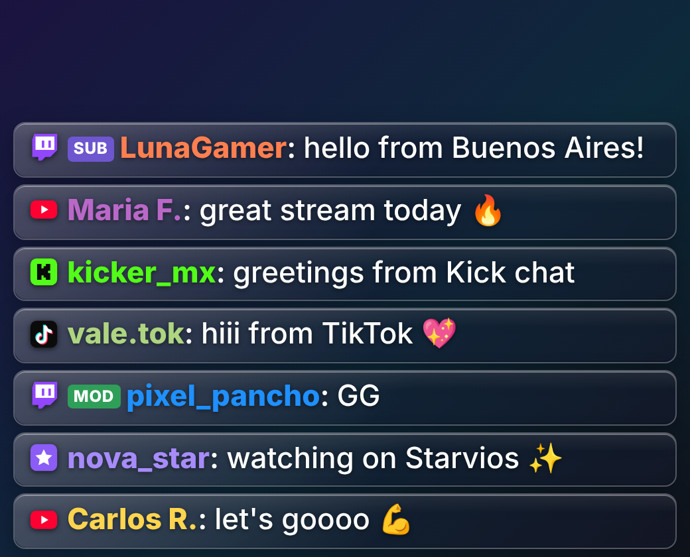
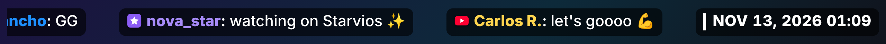

<div align="center">

# 💬 AC Multichat

**Twitch, YouTube, Kick, TikTok and Starvios chats together in one OBS dock and on your scene. It detects when you multistream and connects only the chats of the platforms where you're live.**

[](../../releases/latest)


[](LICENSE)

**English** · [Español](README.es.md)



[**⬇️ Download**](../../releases/latest) &nbsp;·&nbsp; [Install](#-install) &nbsp;·&nbsp; [Features](#-features) &nbsp;·&nbsp; [FAQ](#-faq)

</div>

---

A native OBS Studio 33+ plugin: no Python, no accounts, no API keys, no browser extensions.

## ✨ Features

| | |
|---|---|
| 🧩 **"Multichat" dock** | Every message together with each platform's logo, badges (MOD, VIP, SUB, HOST), emotes, Super Chats, bits, subscriptions and TikTok gifts. |
| 👁 **Viewers** | How many people are watching right now on each platform and in total, in the dock and in the chats window. Updated every 30 s. |
| 📡 **Multistream detection** | When you press *Start Streaming* it checks which platforms you're live on and connects those chats. The dock shows **"Multistream detected"**. |
| ➕ **Many chats** | Add as many channels as you want, several from the same platform too, from **Tools → Multichat: set up chats**. When you type or paste a channel, its profile picture appears so you can check it's the right one. |
| 🎬 **"Multichat" source** | The chat on your scene with a transparent background. Vertical (a list of messages) or horizontal (a ticker scrolling right to left). Layout, speed, size, fade, max messages, platforms, background and alignment are set in its Properties. |
| 👁 **"Multichat (viewers)" source** | A separate box with the logo and viewers of each live channel, plus the total. In a row or a column, with or without the channel name. |
| 🕒 **"Multichat (date and time)" source** | A separate box with the date and time (with or without seconds, 24 h or 12 h, optional bar and background), sized to fit. |
| 🔊 **"Multichat (voice)" source** | Reads the chat aloud with the system voices, as an audio source that reaches the stream and is controlled in the Audio Mixer. |
| 🎨 **Background styles** | A background per message and one behind the whole chat, with color, opacity, rounding and border. Styles: Solid, Glass, Pill, macOS window, Minimal, Line, Synthwave, Neon city, Cyberpunk, Retro and Glitch. |
| 🙈 **Filter** | Click a channel in the dock to hide or show its messages. |
| 🧪 **Test messages** | To try the dock and place the overlay without being live. They never show while you stream. |
| 🔄 **Updates** | OBS tells you when there's a new version and installs it for you after you accept. |



## 📦 Install

Requires **OBS Studio 33 or newer** (Windows 10/11, macOS 13+ or Linux x86_64). With an older OBS the plugin doesn't load and OBS says some plugins "failed to load": update OBS first.

Download the file for your system from **[Releases](../../releases/latest)** and **close OBS before installing**.

| | Windows 10/11 | macOS 13+ | Linux x86_64 |
|---|---|---|---|
| **File** | `obs-multichat-<version>-windows-x64.zip` | `obs-multichat-<version>-macos.zip` | `obs-multichat-<version>-linux-x86_64.tar.gz` |
| **You get** | the `obs-multichat` folder | `obs-multichat.plugin` | the `obs-multichat` folder |
| **Copy it to** | `C:\ProgramData\obs-studio\plugins\` (accept the administrator prompt) | `~/Library/Application Support/obs-studio/plugins/` | `~/.config/obs-studio/plugins/` |
| **Then** | Delete old copies, if any (see below) | Run the Terminal command below (once) | — |

<details>
<summary><b>Windows step by step</b></summary>

Since OBS 33, plugins go in **`C:\ProgramData\obs-studio\plugins`**, one folder per plugin (no longer inside `C:\Program Files\obs-studio`).

1. Unzip `obs-multichat-<version>-windows-x64.zip` (right-click → **Extract All**). You get the `obs-multichat` folder.
2. Open `C:\ProgramData\obs-studio\plugins` (type it in the Explorer address bar; `ProgramData` is hidden). Create the `plugins` folder if it doesn't exist.
3. Copy the `obs-multichat` folder there (replace it if it was already there) and accept the administrator prompt. It must look like this:

   ```
   C:\ProgramData\obs-studio\plugins\obs-multichat\
   ├── obs-multichat.dll
   └── data\
       ├── manifest.json
       ├── locale\
       └── overlay\
   ```

4. If you installed an older version in `C:\Program Files\obs-studio`, delete `obs-plugins\64bit\obs-multichat.dll` and the `data\obs-plugins\obs-multichat` folder: OBS 33 marks that layout as *Legacy* and OBS 34 no longer loads it.
5. Open OBS.
</details>

<details>
<summary><b>macOS step by step</b></summary>

1. Unzip `obs-multichat-<version>-macos.zip`: you get `obs-multichat.plugin`.
2. Copy it to `~/Library/Application Support/obs-studio/plugins/` (in Finder: **Go → Go to Folder…**). Replace the old version if there is one.
3. In Terminal, once:

   ```bash
   xattr -cr ~/Library/Application\ Support/obs-studio/plugins/obs-multichat.plugin
   ```

4. Open OBS.
</details>

<details>
<summary><b>Linux step by step</b></summary>

Built on Ubuntu 24.04 for the OBS from the [official PPA](https://launchpad.net/~obsproject/+archive/ubuntu/obs-studio) (`sudo add-apt-repository ppa:obsproject/obs-studio`); it works on Ubuntu 24.04 or newer and derivatives (Linux Mint 22, Pop!_OS 24.04…). The overlay uses the OBS Browser source: the PPA build has it, the `obs-studio` package from Ubuntu's own repositories doesn't.

```bash
mkdir -p ~/.config/obs-studio/plugins
tar -xzf obs-multichat-*-linux-x86_64.tar.gz -C ~/.config/obs-studio/plugins
```

It must look like this:

```
~/.config/obs-studio/plugins/obs-multichat/
├── bin/64bit/obs-multichat.so
└── data/
    ├── manifest.json
    ├── locale/
    └── overlay/
```

The voice source uses **espeak-ng**, which Ubuntu desktop usually includes; if it's missing: `sudo apt install espeak-ng`.
</details>

> [!TIP]
> If you used the older Python version (`obs_multichat.py`), remove it from **Tools → Scripts**.

### Automatic updates

When OBS opens, the plugin checks this repository's GitHub Releases for a new version. If there is one, it asks with **Update now**, **Later** or **Skip this version** (the **Multichat** dock reminds you with a button). **Update now** downloads it over HTTPS, installs it and asks you to restart OBS. You can also check by hand in **Tools → Multichat: check for updates**. Nothing is installed without your click.

- **Windows:** installs into `C:\ProgramData\obs-studio\plugins\obs-multichat`, which belongs to the administrator: Windows asks for permission once to copy the plugin. A copy in the old folder (`C:\Program Files\obs-studio`) is moved to the new one.
- **macOS:** replaces `obs-multichat.plugin` in its folder and clears the "downloaded from the internet" flag, so macOS doesn't ask again.
- **Linux:** replaces `~/.config/obs-studio/plugins/obs-multichat`, with no permission prompt (downloads with `curl`, or `wget` if `curl` is missing).

To see the installed version: **Tools → Plugin Manager** (OBS 33).

## 🎛️ Use it

1. **Tools → Multichat: set up chats**. Pick the platform, type the channel and press **Add**. You can also paste the channel URL or a YouTube live URL.
2. **Docks → Multichat** to see the chat inside OBS.
3. To show it on screen: **Sources → + → Multichat (on-screen chat)**. For the ticker, choose *Layout → Horizontal*. With *Fit to the canvas automatically* (on by default) it takes the whole canvas width at the height of one line; turn it off to set the size by hand. *Movement* can be continuous or per message (it moves with each message and stops). With *Show date and time at the end of the ticker*, the ticker ends with the date and time on the right.
4. Viewers on screen: **Sources → + → Multichat (viewers)**.
5. Date and time on their own: **Sources → + → Multichat (date and time)**.
6. To read the chat aloud: **Sources → + → Multichat (voice)**. See [Read the chat aloud](#-read-the-chat-aloud).

The plugin's interface is in English and Spanish (it follows the OBS language).

### 🔊 Read the chat aloud

Works on Windows, macOS and Linux with the system voices, with no external services. On Linux it uses **espeak-ng**: the voice is more robotic than on Windows and macOS.

1. Add **Sources → + → Multichat (voice)** to your scene.
2. In its **Properties**, turn on *Read chat aloud* (it starts off). There you choose the voice, the speed, whether the sender's name is read, which platforms are read, the maximum characters per message and blocked words.
3. Control the volume in the **Audio Mixer** like any other source. It is OBS audio: it reaches the stream and the recording. To hear it yourself, turn on monitoring in *Advanced Audio Properties*.

What is read and what isn't:

- Only new messages, never the history, and only while the source is in the scene on program. If it leaves the scene, the queue is cleared.
- Emotes, links and emojis are not read. A message left with no letters or numbers is skipped.
- Chat notices (subscriptions, gifts…) are read. A Twitch `/me` is read as "Ana waves".
- A message with a blocked word is not read at all.
- Messages are read one at a time. If the queue reaches 20, the oldest is dropped so the delay doesn't grow.
- *Skip current message* cuts the one being read. Disabling the source clears the queue and stops the voice.
- *Test messages* are read too, so you can hear the voice without being live, but never while you stream.

Limits: the first message can take a few seconds while the system loads the voice, and only links starting with `http://`, `https://` or `www.` are removed, so `example.com` would be read.

### When each chat connects

| Mode | Behavior |
|---|---|
| **Automatic** (default) | Checks every minute which channels are live and connects only those chats. When you start streaming it checks every 15 s for 3 minutes. If a channel's state can't be known, it connects while OBS is streaming. |
| **Always connected** | Connects every chat even when you're not live. YouTube, TikTok and Starvios wait for the live to start. |

It works with any way of multistreaming (Restream, *Multiple RTMP outputs*, Aitum Multistream…), because it asks each platform directly. If the OBS streaming service is Restream, Castr or StreamYard, it's also marked as multistream.

### Platform notes

- **Twitch:** anonymous, read-only IRC connection.
- **YouTube:** reads the public live chat, no API key. With `@channel` it looks only for the active live.
- **Kick:** Kick sometimes blocks the request that gives the chat ID. If the channel shows an error, add it with the ID: `mychannel#123456`. To find it, open `https://kick.com/api/v2/channels/mychannel` in the browser and look for `"chatroom":{"id":…}`.
- **TikTok:** type your username (`@mychannel`) or paste the URL. TikTok requires the chat connection to be signed, so the plugin uses [Euler Stream](https://www.eulerstream.com), a free external service with no account that limits connections per day. Over the limit, the chat shows an error and retries after 10 minutes. Shows comments and gifts.
- **Starvios:** type your username (`mychannel`) or paste the URL (`https://starvios.com/live/mychannel`). No account or key: the chat is read anonymously and read-only, the same way its website does, and the plugin doesn't count as a viewer. Messages missed during a reconnection are shown but not read aloud. **This connector is unofficial** and may stop working if Starvios changes.

YouTube, Kick, TikTok and Starvios have no official public API to read the chat without an account: if they change their site, the plugin may need an update.

## ❓ FAQ

<details>
<summary><b>OBS says the plugin "failed to load"</b></summary>

You're on OBS 32 or older. Update OBS to 33 or newer. On Windows, also check the plugin is in `C:\ProgramData\obs-studio\plugins\obs-multichat\` and not in the old `C:\Program Files\obs-studio` folders.
</details>

<details>
<summary><b>A chat stays in error</b></summary>

**Tools → Multichat: set up chats** shows the reason under the channel. For Kick, add it with the chat ID (see [Platform notes](#platform-notes)). For TikTok, the free signing service may have reached its daily limit: it retries by itself after 10 minutes. The OBS log (**Help → Log Files**) has the `[obs-multichat]` lines.
</details>

<details>
<summary><b>The chat doesn't connect when I'm not live</b></summary>

That's the **Automatic** mode: it connects only the channels that are live. Switch to **Always connected** in **Tools → Multichat: set up chats**, or use *Test messages* to place the overlay.
</details>

<details>
<summary><b>macOS says the plugin is damaged or blocks it</b></summary>

Run the `xattr -cr …` command from the install steps. The plugin isn't signed with a paid Apple developer account.
</details>

## 🔒 Privacy

- No accounts, no logins, no telemetry. Everything runs inside OBS on your computer; there's no server of ours.
- To read the chats and viewer counts, the plugin talks directly and anonymously to each platform you add: Twitch (IRC and its public GraphQL), YouTube, Kick, TikTok and Starvios (its public Supabase endpoint). Emotes and profile pictures are loaded from the platforms' own image servers.
- **TikTok only:** the room ID of the TikTok channel you add is sent to [Euler Stream](https://www.eulerstream.com) to sign the connection.
- **Updates:** the plugin asks the GitHub API for this repository's latest release when OBS opens and, only if you accept, downloads it from GitHub.
- The channels you add and your settings are saved in the OBS configuration folder on your computer.

## 🛠️ For developers

<details>
<summary><b>Build, tests and project layout</b></summary>

The plugin uses the [official OBS plugin template](https://github.com/obsproject/obs-plugintemplate) updated to **OBS 33.0.0**: obs-deps and Qt 6.11 from `2026-10-23`, macOS 13+ universal, Windows x64. Configuring downloads the dependencies by itself. On Linux it uses the system OBS, Qt 6, libcurl and espeak-ng.

```bash
# macOS (Xcode 26.5+: OBS 33 requires the macOS 26.5 SDK)
cmake --preset macos && cmake --build --preset macos

# Windows (Visual Studio 2022, SDK 10.0.26100)
cmake --preset windows-x64
cmake --build --preset windows-x64

# Ubuntu 24.04 (with the OBS from the official PPA)
sudo apt install obs-studio qt6-base-dev qt6-base-private-dev libcurl4-openssl-dev libespeak-ng-dev libsimde-dev ninja-build
cmake --preset ubuntu-x86_64 && cmake --build --preset ubuntu-x86_64
```

Parser tests (no OBS or network, only Qt 6 Core):

```bash
cmake -S tests -B build_tests && cmake --build build_tests && ctest --test-dir build_tests
```

Every push builds on GitHub Actions for Windows, macOS and Linux (`.github/workflows/build.yml`). To publish a version, bump `version` in `buildspec.json` and in `data/manifest.json` (CI checks they match) and push it to `main`: the *Publicar versión* workflow creates the `v<version>` tag and the Release with the packages for the three systems.

```
src/plugin-main.cpp        plugin load, dock, menu and streaming events
src/chat-manager.*         live / multistream detection and chat lifecycle
src/overlay-source.cpp     "Multichat", "Multichat (viewers)" and "Multichat (date and time)" sources (private browser sources)
src/tts/                   "Multichat (voice)" source: text filter, queue, real-time output and voice (AVSpeechSynthesizer on macOS, SAPI on Windows, espeak-ng on Linux)
src/chat/                  connectors and parsers: twitch, youtube, kick, tiktok, starvios, demo
src/net/                   system networking: WinHTTP (Windows), NSURLSession (macOS) and libcurl (Linux)
src/ui/                    dock, settings window, emote and profile caches
src/updater.*              automatic updates from GitHub Releases
data/overlay/              chat (index.html), viewers (viewers.html) and date and time (clock.html) pages
data/locale/               English and Spanish strings
```

Why native networking and not QtNetwork? OBS 33 doesn't ship Qt's TLS plugins, so HTTPS through QtNetwork doesn't work inside OBS. WinHTTP and NSURLSession handle HTTPS and WebSocket with no extra dependencies. On Linux, libcurl (which OBS already uses) does HTTPS and the WebSocket TLS connection; the WebSocket protocol lives in `src/net/net-linux.cpp`.
</details>

## 📄 License

GPL-2.0 or later, like every plugin that links against libobs — see [LICENSE](LICENSE).

AC Multichat is an independent project, not affiliated with or endorsed by the OBS Project, Twitch, YouTube, Kick, TikTok or Starvios.
